# Notification Samples

A single-screen Android app that shows every common notification type, from a basic one to bubbles. Each card on the screen calls exactly one function in `NotificationSamples.kt`.

Kotlin · Jetpack Compose · `NotificationCompat` (androidx.core) · minSdk 24 · targetSdk 37 · no extra dependencies.

## Screenshots

All screenshots are from an Android 17 (API 37) emulator.

### Screens

<table>
  <tr>
    <td align="center">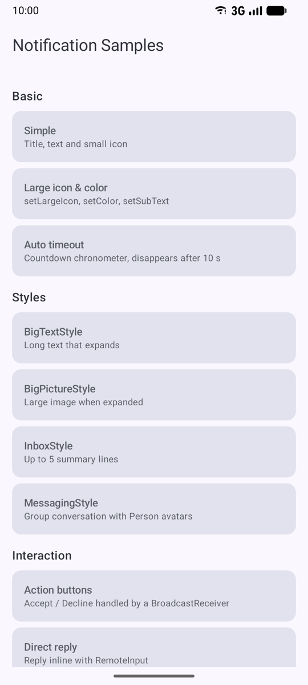<br><sub>Sample catalog</sub></td>
    <td align="center">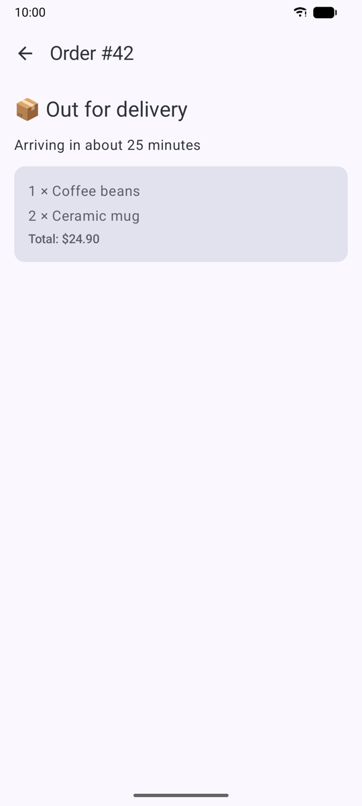<br><sub>Deep link → order screen</sub></td>
    <td align="center">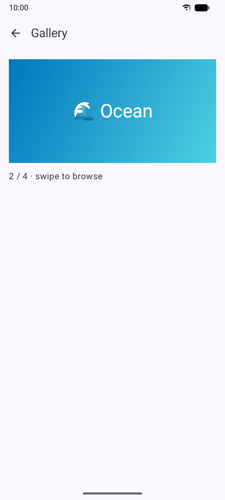<br><sub>Slider tap → gallery</sub></td>
  </tr>
  <tr>
    <td align="center">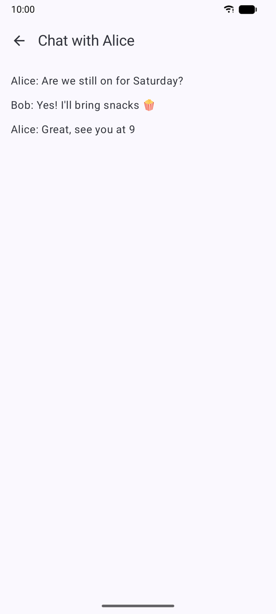<br><sub>Deep link → chat screen</sub></td>
    <td align="center">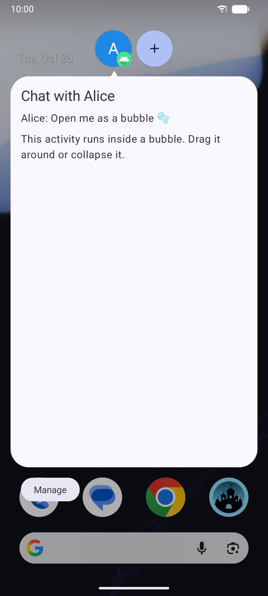<br><sub>Bubble</sub></td>
    <td align="center">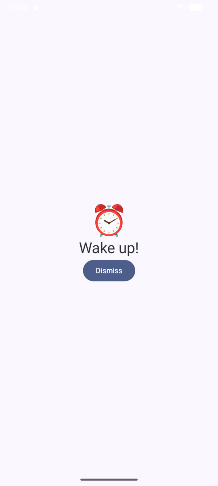<br><sub>Full-screen intent over the lock screen</sub></td>
  </tr>
</table>

### Notifications

<table>
  <tr>
    <td>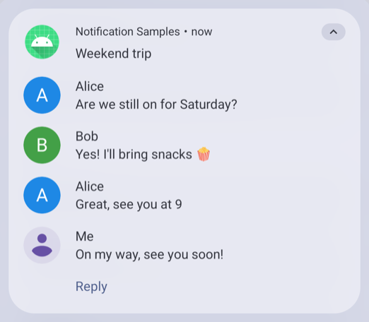<br><sub>MessagingStyle + direct reply</sub></td>
    <td>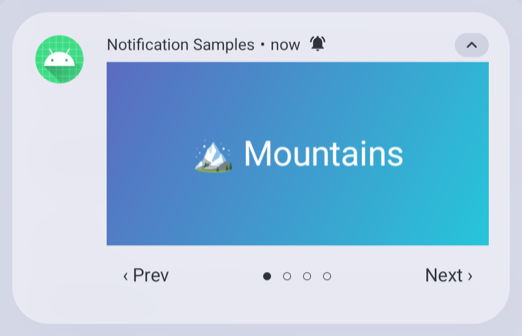<br><sub>Image slider (Prev / Next)</sub></td>
  </tr>
  <tr>
    <td>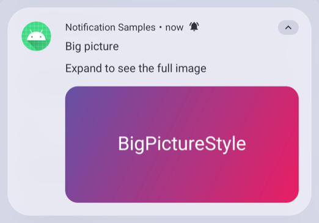<br><sub>BigPictureStyle</sub></td>
    <td>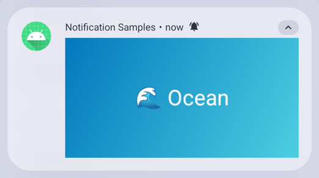<br><sub>Auto-play carousel</sub></td>
  </tr>
  <tr>
    <td>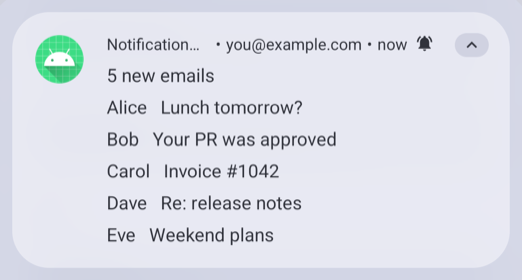<br><sub>InboxStyle</sub></td>
    <td>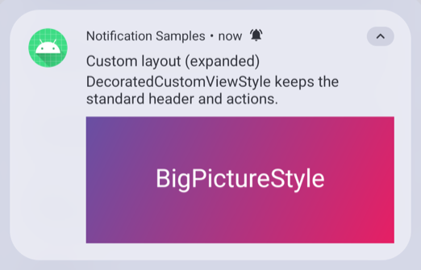<br><sub>Custom layout (DecoratedCustomViewStyle)</sub></td>
  </tr>
  <tr>
    <td>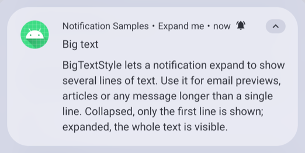<br><sub>BigTextStyle</sub></td>
    <td>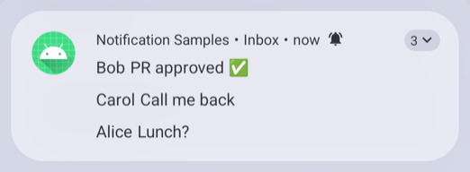<br><sub>Grouped</sub></td>
  </tr>
  <tr>
    <td>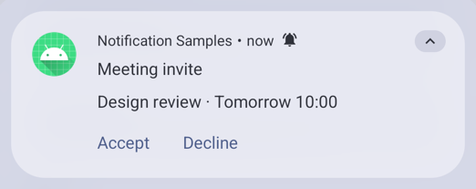<br><sub>Action buttons</sub></td>
    <td>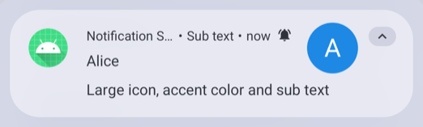<br><sub>Large icon & color</sub></td>
  </tr>
  <tr>
    <td>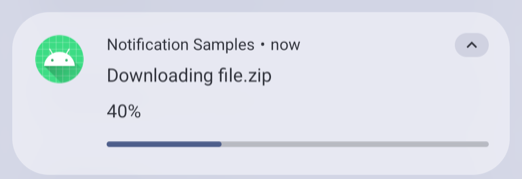<br><sub>Determinate progress</sub></td>
    <td>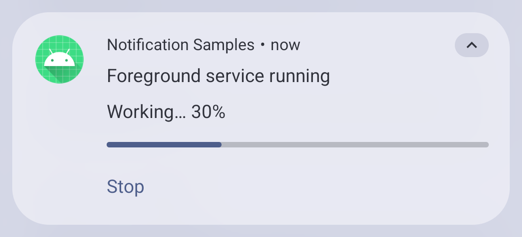<br><sub>Foreground service</sub></td>
  </tr>
  <tr>
    <td>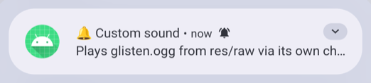<br><sub>Custom sound channel</sub></td>
    <td></td>
  </tr>
</table>

## Samples

| Section | Sample | Key APIs |
|---|---|---|
| Basic | Simple | `NotificationCompat.Builder`, `setContentIntent` |
| | Large icon & color | `setLargeIcon`, `setColor`, `setSubText` |
| | Auto timeout (API 26+) | `setTimeoutAfter`, `setChronometerCountDown` |
| Styles | BigTextStyle | `BigTextStyle` |
| | BigPictureStyle | `BigPictureStyle`, `bigLargeIcon(null)` |
| | InboxStyle | `InboxStyle`, `setNumber` |
| | MessagingStyle | `MessagingStyle`, `Person` |
| Interaction | Action buttons | `addAction` → `BroadcastReceiver` |
| | Direct reply | `RemoteInput`, mutable `PendingIntent`, re-post to update |
| Deep links | Order / Chat / Profile screen | `notificationsamples://…` data Uri, `singleTop` + `onNewIntent`, back stack |
| Sound & images | Custom sound | channel `setSound(res/raw/glisten.ogg)` |
| | Image slider | `RemoteViews`, Prev/Next re-post with `setOnlyAlertOnce`, tap → in-app gallery |
| | Auto-play carousel | `ViewFlipper` (`autoStart`) inside `RemoteViews` |
| Progress | Determinate | `setProgress(max, p, false)`, `setOnlyAlertOnce` |
| | Indeterminate | `setProgress(0, 0, true)`, `setOngoing` |
| | Foreground service | `ServiceCompat.startForeground`, `dataSync` type |
| Grouping & priority | Grouped | `setGroup`, `setGroupSummary`, `GROUP_ALERT_SUMMARY` |
| | Heads-up | `IMPORTANCE_HIGH` channel, `PRIORITY_HIGH` |
| | Full-screen intent | `setFullScreenIntent`, `canUseFullScreenIntent()` (API 34+) |
| | Silent | `IMPORTANCE_MIN`, `setSilent`, `BADGE_ICON_NONE` |
| Advanced | Custom layout | `RemoteViews`, `DecoratedCustomViewStyle` |
| | Bubble (API 30+) | `BubbleMetadata`, long-lived `ShortcutInfoCompat` |
| | Scheduled | `AlarmManagerCompat.setAndAllowWhileIdle` |
| | Update / cancel | same id re-post, `cancelAll` |
| | Channel settings | `ACTION_CHANNEL_NOTIFICATION_SETTINGS` |

## Channels

| Id | Importance | Group | Used by |
|---|---|---|---|
| `default` | DEFAULT | System | basic, styles, actions, groups |
| `messages` | HIGH | Social | messaging, direct reply, bubble |
| `progress` | LOW | System | progress, foreground service |
| `alerts` | HIGH (+ vibration) | System | heads-up, full-screen |
| `silent` | MIN | System | silent |
| `custom_sound_glisten` | HIGH | Social | custom sound |

A channel's sound can't be changed after the channel exists. To use a different sound, ship a new channel id.

## Deep links & navigation

Tapping a notification goes straight to a screen, not just the app's start screen:

| Uri | Screen |
|---|---|
| `notificationsamples://order/42` | Order details |
| `notificationsamples://chat/Alice` | Chat (also used by Messaging, Direct reply, Bubble) |
| `notificationsamples://profile` | Profile |
| `notificationsamples://gallery/2` | Swipeable gallery at slide 2 (from the slider notifications) |

- If the app is already running, `MainActivity` (`singleTop`) gets `onNewIntent` and pushes the screen onto its back stack. Nothing relaunches.
- On a cold start, the stack is `[home, target]`, so Back always returns to the home screen.
- `routeOf()` accepts only known route shapes, because any app can send these Uris.
- Try one from a shell: `adb shell am start -a android.intent.action.VIEW -d notificationsamples://order/42`

## Code map

```
app/src/main/java/com/techgv/notificationsamples/
├── MainActivity.kt                # catalog (sections list), permission request, back stack
├── Navigation.kt                  # deep-link routes, routeOf(), destination screens
├── NotificationSamples.kt         # one function per sample + the post() helper
├── NotificationChannels.kt        # channels and channel groups
├── NotificationActionReceiver.kt  # action buttons, direct reply, slider, scheduled alarm
├── ProgressService.kt             # foreground service sample
├── FullScreenActivity.kt          # alarm screen shown over the lock screen
├── BubbleActivity.kt              # content inside the bubble
└── NotificationApp.kt             # creates channels at startup
```

All posts go through `Samples.post()`, which checks that notifications are enabled, checks that the channel is not blocked and catches `SecurityException`.

## Requirements

- Android Studio with Android SDK Platform 37 installed (`compileSdk = 37`).
- JDK 25 for the Gradle daemon (see `gradle/gradle-daemon-jvm.properties`); the Gradle wrapper (9.6) downloads itself.
- A device or emulator running API 24 or higher. API 34+ is recommended, because it covers the notification permission and full-screen intent paths.

## Running

```
./gradlew installDebug
./gradlew lintDebug
./gradlew connectedDebugAndroidTest   # needs a connected device or emulator
```

The instrumented tests check posting, in-place updates, that Cancel all stops running progress, slider wrap-around, deep-link parsing, and warm deep-link navigation. They also include a smoke test that starts every sample once. The smoke test only checks that nothing throws, not how the notifications look.

## Contributing

Issues and pull requests are welcome. To add a sample:

1. Add one function to `Samples` in `NotificationSamples.kt` that builds and posts the notification through `Samples.post()`.
2. Add a `Sample(...)` entry to `sections` in `MainActivity.kt`. Set `minSdk` if the API it shows needs one.
3. Run `lintDebug` and `connectedDebugAndroidTest`, and add a test if the sample has behaviour beyond posting.

On Android 13+ the app asks for `POST_NOTIFICATIONS` on first launch. If you deny it, a banner on the screen links to settings.

## Device notes

- **Full-screen intent** only takes over the screen when the device is locked. When the device is in use, it shows as a heads-up. On Android 14+ the user must also allow it.
- **Bubbles** depend on the user's bubble setting and the launcher. If no bubble appears, tap the bubble icon on the notification.
- **Scheduled** uses an inexact alarm. It never fires before 10 s, but the system may batch it later. It survives closing the app, but not a force-stop or a reboot.
- **Foreground service, known issue (unconfirmed):** on a Realme RMX2103 (ColorOS, API 30), starting the service and pressing Cancel all in quick succession once left a foreground-service notification in the shade that the app could not remove. It was reproduced by `cancelAllStopsAQueuedForegroundServiceStart`, before a later fix that cancels the notification in `onDestroy`. It has not been re-tested on that device since. It doesn't happen on API 37 emulators. Reports from other devices are welcome.
- **Auto-play carousel** has no pause control. The manual **Image slider** is the accessible option.

## License

The source code is licensed under the [Apache License 2.0](LICENSE). Copyright 2026 GvHarish9894.

## Credits

The custom sound is "Glisten" from [akx/Notifications](https://github.com/akx/Notifications) (CC0 / CC BY 3.0). See [CREDITS.md](CREDITS.md).
